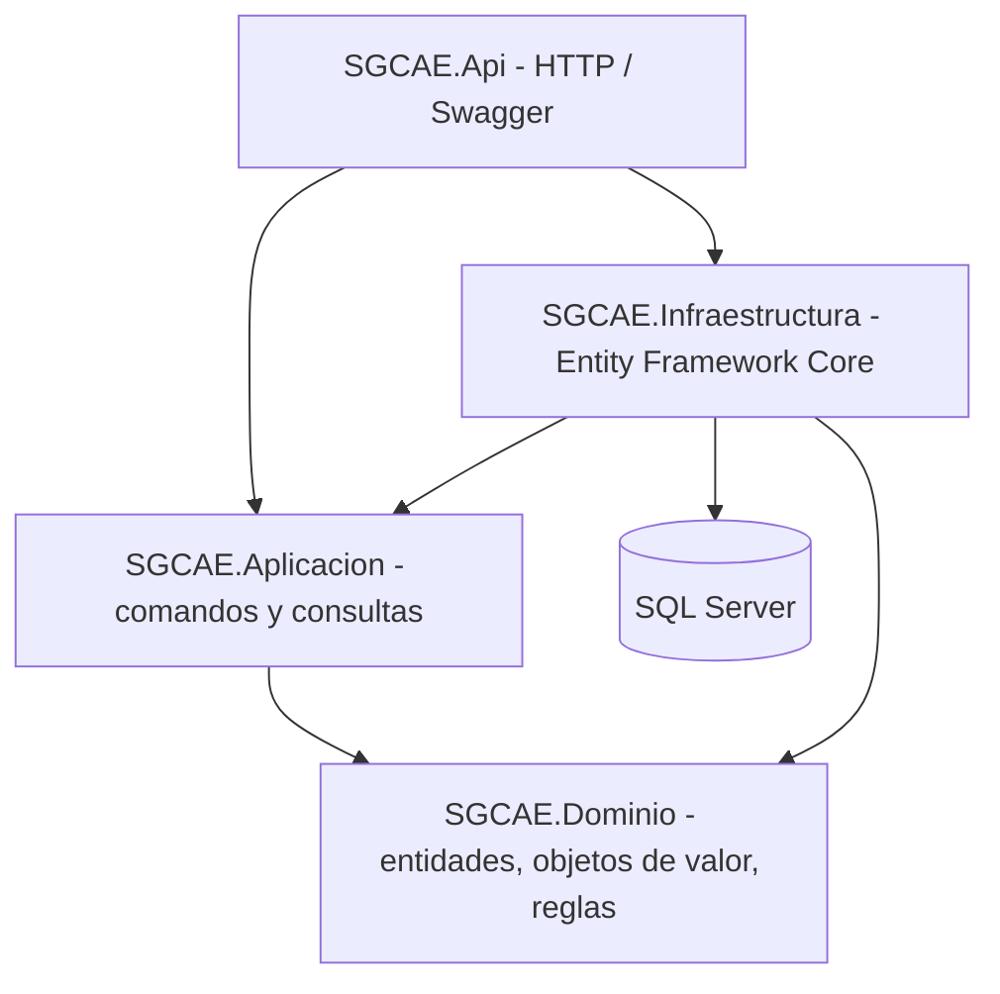
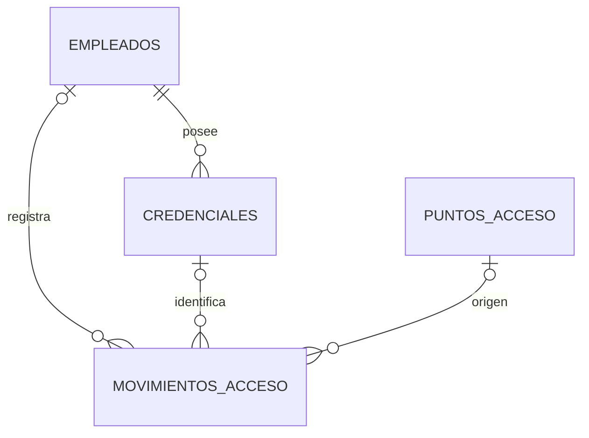

# Arquitectura y explicación para la sustentación — SGCAE

## 1. Necesidad

La empresa registra accesos manualmente; existen duplicados, poca trazabilidad y riesgo de permitir ingresos de empleados inactivos. SGCAE centraliza en SQL Server el control de empleados, credenciales, puntos de acceso y movimientos.

## 2. Clean Architecture

- **Dominio:** no depende de EF, SQL ni HTTP. `Empleado`, `Credencial`, `PuntoAcceso`, `MovimientoAcceso`, `CorreoElectronico`, `CodigoCredencial` y reglas.
- **Aplicación:** casos de uso, interfaces de repositorios, contratos y DTO. Los manejadores dependen solo de abstracciones y del dominio.
- **Infraestructura:** implementa repositorios con EF Core y define migraciones SQL Server.
- **API:** recibe HTTP, valida modelos, inyecta manejadores, configura Swagger y errores.

## 3. DDD (Domain Driven Design)

Entidades con identidad (`Guid`): Empleado, Credencial, PuntoAcceso, MovimientoAcceso. Los objetos de valor normalizan la información (`CorreoElectronico`, `CodigoCredencial`). Las reglas se ejecutan en métodos del dominio y manejadores de casos de uso, en vez de dispersarse en controladores.

Invariantes: documento de empleado único, código de credencial único, empleado activo para asignar credencial y permitir el acceso, credencial Vigente, punto Habilitado, no repetir consecutivamente Entrada/Entrada o Salida/Salida en el mismo punto.

## 4. CQRS (Command Query Responsibility Segregation)

**Commands** mutan y guardan con `IUnidadTrabajo`: `CrearEmpleadoComando`, `DesactivarEmpleadoComando`, `AsignarCredencialComando`, `RegistrarAccesoComando`, etc. **Queries** leen sin cambios: `ObtenerEmpleadoConsulta`, `ListarEmpleadosConsulta`, `ConsultarHistorialConsulta`, etc. Ambos grupos tienen manejadores diferentes y contratos explícitos. Es CQRS de separación lógica, no implica dos bases de datos distintas.

Ejemplo: `POST /api/accesos` -> `RegistrarAccesoComando` -> `RegistrarAccesoManejador` -> reglas -> persistir `MovimientoAcceso` (incluso Rechazado). `GET /api/accesos/historial` -> `ConsultarHistorialConsulta` -> `ConsultarHistorialManejador` -> paginación y filtros.

## 5. Estados

- EstadoLaboral: Activo / Inactivo.
- EstadoCredencial: Vigente / Bloqueada / Revocada.
- ResultadoAcceso: Autorizado / Rechazado.
- TipoMovimiento: Entrada / Salida.

## 6. Modelo de datos

Las referencias desde `MovimientosAcceso` son opcionales a propósito: si alguien escanea una tarjeta inexistente, igual se registra la solicitud con el código proporcionado y la causa del rechazo.

## 7. Casos concretos para mostrar

1. Crear empleado activo y consultar su registro (RF-01).
2. Crear punto RECEPCION habilitado (RF-06).
3. Asignar credencial TARJETA-01 (RF-02).
4. Entrada válida -> Autorizado (RF-03).
5. Nueva Entrada consecutiva -> Rechazado y guardado (RF-03).
6. Salida -> Autorizado (RF-03).
7. Bloquear tarjeta -> Rechazado (RF-02 y RF-03).
8. Filtrar historial por empleado, resultado y pagina=1/tamanoPagina=2 (RF-04).
9. Desactivar empleado -> cualquier acceso posterior Rechazado (RF-01 y RF-03).
10. SQL Server Object Explorer -> ver tablas y datos guardados.

## 8. Guion de exposición (4-5 minutos)

**Inicio (30 s):** "Mi proyecto SGCAE reemplaza planillas de seguridad por una API en ASP.NET Core y SQL Server. Cumple cinco requisitos funcionales del seguimiento."

**Arquitectura (1 min):** "Separé las responsabilidades en cuatro proyectos. Dominio tiene la lógica y reglas. Aplicación contiene los casos de uso. Infraestructura utiliza Entity Framework Core y SQL Server. Api expone REST y Swagger."

**DDD / CQRS (1 min):** "Los empleados y credenciales son entidades, mientras correo y código de credencial son objetos de valor. CQRS separa comandos que escriben de consultas que leen, y se usa inyección de dependencias."

**Demostración (2 min):** Mostrar Swagger, crear empleado, punto, credencial, registrar autorización y rechazo, y consultar historial paginado. Mostrar SQL Server Object Explorer con las tablas.

**Cierre (30 s):** "Las entradas y salidas quedan auditadas incluso cuando se rechazan, el sistema impide acceso a empleados inactivos y se puede consultar de manera centralizada. El repositorio público contiene código y pruebas automatizadas."

## 9. Alcance real

Es un backend académico funcional. No integra lectores RFID, biometría, autenticación de guardias ni roles. El documento del profesor no pide esos elementos. Para desplegar en producción se debe añadir autenticación/autorización, gestión de secretos, controles de concurrencia, rate limiting y monitoreo.
